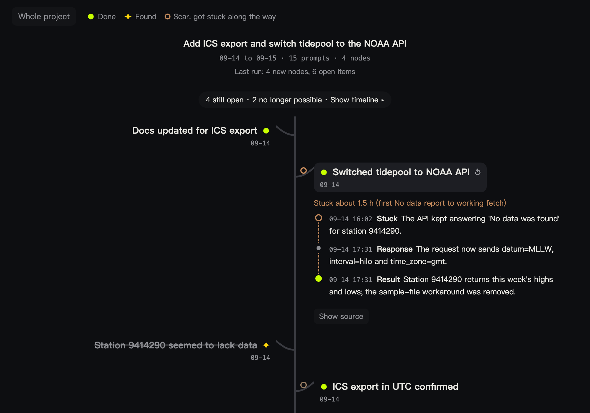
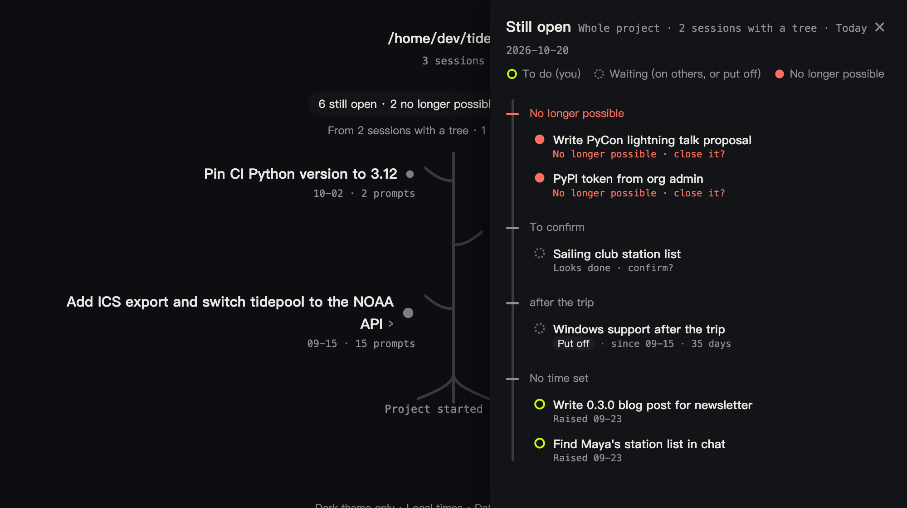

# treesight

**English** | [中文](README.zh-CN.md)

See your Claude Code sessions as trees: what each one got done, what it found out, and what is still open across the project.

Once sessions pile up, it is hard to remember what a session from three weeks ago settled and what it left hanging. treesight reads the session transcripts on your machine, has Claude pick out each session's landmarks (things done, things found out, where it got stuck) and its open items (yours to do, or waiting on someone), and draws them on a local page. The open items of every session in the project end up in one list: who you are waiting on and for how long, what is overdue, what is blocked by what.

> [!NOTE]
> Unofficial and not affiliated with Anthropic. Early release: works in Claude Code only, dark theme only.

<p align="center">
  
</p>
<p align="center">
  
</p>
<p align="center"><sub>The made-up sample project in this repository (<code>docs/demo.html</code>, built by <code>dev/make_sample.py</code>), captured on 2026-10-20, so day counts run to that date. The screenshots show the English interface; browsers that prefer Chinese get the page in Chinese.</sub></p>

## Quick start

1. Install the plugin in Claude Code:

   ```
   /plugin marketplace add kuk1song/treesight
   /plugin install treesight@treesight
   ```

   On Claude Code 2.1.275 or later, `/plugin install treesight --marketplace kuk1song/treesight` does both in one step.

2. In the session you want to see, run:

   ```
   /treesight:treesight
   ```

   A few seconds later (7 to 12 seconds in testing) the page opens with what is already known and says the session is being drawn. Extraction runs in the background, so you can keep working; the page reloads itself and shows the new tree when it is done. If you start another `/treesight:treesight` while one is still running, Claude Code runs the second one in the foreground, so your conversation waits until it is done.

3. To draw another session of the same project, add its id or words from its title: `/treesight:treesight 0a182a7b` or `/treesight:treesight release`. Sessions without a tree show up on the project page with the command to run.

4. To correct the page by hand: `/treesight:treesight close <words from the item>`, or `reopen`, `hide`, or `set <item> when=after the trip` (fields: label, line, kind, due, when, who, rank, score, blocked_by). Your corrections always win over extraction.

Needs Claude Code (tested with 2.1.299), `python3` 3.9 or later (the one that comes with macOS works), and macOS or Linux. Windows is untested.

## How it works

1. **Read.** A script reads the session's transcript in `~/.claude/projects` without any model, removes common secret formats, masks IPv4 addresses and emails, and writes a digest of prompts, replies, automatic recaps and compaction summaries. Texts are kept whole: only pasted content (its first 400 characters), compaction summaries (their key sections, up to 8,000 characters) and any single entry longer than a whole digest are shortened, and the digest says so. treesight's own command and the turn your conversation spends on its report are left out.
2. **Extract.** The skill runs in a separate subagent, so your conversation is left as it is. It uses the same model and account as your Claude Code. The skill pre-approves only two things: running treesight's own script, which also prints the digest for it to read, and writing its result under `~/.cache/treesight`. Anything else it tried would follow your usual permission settings. Every node and open item it adds must carry a quote copied from the session; it can also propose closing an open item, again with a quote.
3. **Check and save.** Before anything is saved, a script checks the output against a JSON Schema and checks that every quote really appears in the message it cites. Results go into an append-only ledger. What is saved stays as it is; the next run reads only new messages. Unsure closes and items that look impossible now are left for you to confirm. A quote said before an item was raised cannot close it. If you draw an older session after newer ones, its new items are checked against what the newer sessions recorded, since those runs never saw them.
4. **Draw.** A script builds one static HTML page per project from the ledger. No model is involved.

Where things live: the ledger is in `~/.local/share/treesight/` (or `$XDG_DATA_HOME/treesight`, or `$TREESIGHT_HOME`) and is not deleted when you uninstall the plugin. It also keeps each session's title and times, so a session stays on the page after Claude Code deletes its transcript (after 30 days by default). Pages are in the plugin's data folder, which Claude Code removes on uninstall; they can be rebuilt. While a run is going on, its digest and extraction are in `~/.cache/treesight/work/` (or `$TREESIGHT_WORK`, but then Claude Code asks before writing there); they are deleted once saved. Only you can read any of these files.

## What it costs

Extraction counts against your Claude Code plan like any other request. treesight favours finding every open item over speed and cost, so the skill runs at xhigh effort whatever effort your session uses (only the `CLAUDE_CODE_EFFORT_LEVEL` environment variable overrides it); the model is your session's. Nearly all of the time goes into the model's thinking and its written extraction, at about 110 output tokens a second. Full runs measured on 2026-10-16 with Opus 5.5 at xhigh effort, in manual permission mode with no permission denied, shown as API-price equivalents:

| Session | Time | Cost |
|---|---|---|
| Made-up sample, 15 prompts | 3.1 min | $0.64 |
| A real session, 4 prompts | 4.0 min | $0.97 |
| A real session, 73 prompts and 7 compactions, read in two passes | 21 min | $8.50 |

On that 73-prompt session the run found all 17 items the session's own last pending list named (16 matched by a script, the 17th checked by hand because it was worded differently; the list itself has not been reviewed by hand yet), plus earlier ones the list had dropped. An earlier version cut every prompt and the last reply of each turn to 1,500 characters and the other replies to 500; on a real 8-prompt session it missed 8 open items that the current version found. With that earlier version, lower effort or a smaller model found only 3 to 10 of the 17. Later runs on the same session only read what is new. Redrawing the page uses no model.

## Privacy

- The page makes no network requests. Its Content Security Policy allows no network access and no script but its own, and the data sits in a non-executing block, so text from a session cannot run as code.
- The digest reaches the model the same way your Claude Code conversation does: same account, same provider. Common secret formats are removed and IPv4 addresses and emails masked before that.
- treesight sends nothing anywhere else.

## Compared with

Checked against each project's own README or docs on 2026-10-15.

| Tool | What it does | What treesight adds |
|---|---|---|
| Claude Code agent view, desktop sidebar, Projects | Show what each session is doing now: running, needs your input, done. Projects' "Waiting on you" covers only cloud threads. | What each session got done, and what is still open across sessions, from the transcripts. |
| [loose-ends](https://github.com/MiguelProz/claude-loose-ends) | A Claude Code mod that proposes unfinished items from the current conversation, quoted literally, and closes one only when you confirm with the sentence that proves it. | The same quote rule across every session of a project, plus who you wait on, for how long, and what is blocked, and the session tree. |
| [openloops](https://github.com/thorwhalen/openloops) | Lists what is owed and blocked, with day counts, from GitHub issues; session summaries without a model. | Open items taken from what was said in the sessions. |
| [alluvia](https://github.com/dylanp12/alluvia) | A Claude Code plugin that extracts decisions with verbatim, string-matched quotes and lists unresolved questions; uses your configured LLM provider and API key. | A tree per session and the project-wide open list, using Claude Code itself. |
| [context-visualizer](https://github.com/Abudulaz/context-visualizer) | Draws typed milestones from the transcripts, linked back to the source; needs an OpenRouter key. | Open items, and no extra key. |

## Limitations

- Extraction is not deterministic. With the earlier version, two runs on the same large session shared about 70% of their nodes and listed 27 and 38 open items. The ledger keeps the first result rather than redrawing it.
- One digest holds up to 150,000 characters; more new text is read in passes, at most two per run, and the next run goes on where the last one stopped.
- The report of a run goes back to your conversation. treesight asks Claude there not to act on it, but it may still comment.
- The page is opened by the background run's second step, so it waits for the model's first reply. Once in testing that reply broke off and Claude Code had to ask for it again, so the page opened after 3.4 minutes.
- An older session drawn after newer ones is checked only against what those recorded as nodes and closes. Something they settled without recording it stays open until you close it.
- The transcript format is internal to Claude Code and may change in any release; all reading of it is in `scripts/transcript.py`.
- The page cannot run the extraction itself: run the command in Claude Code, then reload the page.
- Dark theme only. Windows is untested.

## Development

Tests, checks, pull requests and releases are in [CONTRIBUTING.md](CONTRIBUTING.md). The design and its reasons are in [docs/design.md](docs/design.md) (in Chinese), and the data formats in [schema/](schema/).

## License

[MIT](LICENSE)
