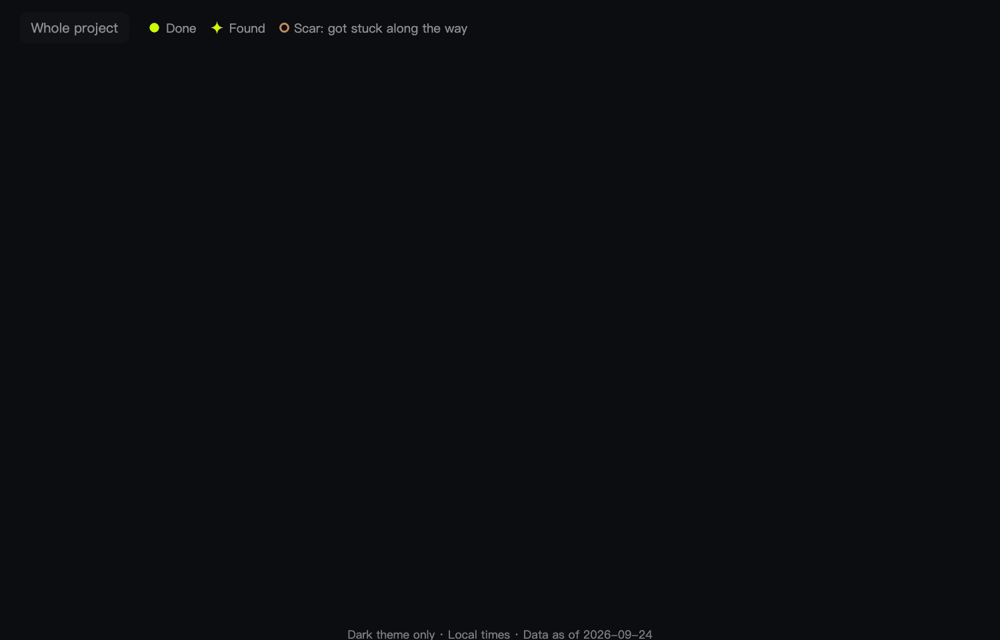

<div align="center">


# treesight

**Recall what each AI coding session did, and what it left open.**

**English** · [中文](README.zh-CN.md)

</div>

Three weeks on, it is hard to remember what a session settled and what it left hanging. treesight has Claude read a session's transcript on your machine and draws it as a tree: what got done, what was found, where it got stuck, and what is still open, whether it is yours to do or you are waiting on someone. The open items of every session in the project come together in one list.

It runs inside your own Claude Code: no server, no account, no extra API key, and the page makes no network requests.



<sub>The made-up sample project in this repository (`docs/demo.html`, built by `dev/make_sample.py`), recorded on 2026-10-20, so day counts run to that date. The animation shows the English interface; the page is in Chinese when the browser lists Chinese before English among its preferred languages.</sub>

> [!NOTE]
> Unofficial and not affiliated with Anthropic. Early release: Claude Code only, dark theme only.

## Install

In Claude Code 2.1.275 or later:

```
/plugin install treesight --marketplace kuk1song/treesight
```

Then choose where to install it. On an older version, run `/plugin marketplace add kuk1song/treesight` and then `/plugin install treesight@treesight`.

**Letting your coding agent set it up?** Ask it to run this in a terminal (Claude Code 2.1.292 or later), then run `/reload-plugins` yourself or start a new session:

```
claude plugin install treesight --marketplace kuk1song/treesight
```

It works in Claude Code on your own computer: tested in the terminal, while the desktop app's Code tab and the IDE extensions should work but are untested. It does not run in cloud sessions, Cowork, claude.ai chat or other coding agents ([details](docs/design.md#5-delivery)).

treesight also needs `python3` 3.9 or later (the one that comes with macOS works) on macOS or Linux; Windows is untested. Tested with Claude Code 2.1.299. Updates are off by default for a marketplace like this one: turn them on in `/plugin`, or run `claude plugin update treesight@treesight`.

## Use

Open the session you want to see (for example with `claude --resume`) and run:

```
/treesight:treesight
```

Within seconds treesight asks your browser to open the page, and the session's tree appears there when the background run is done, a few minutes for most sessions. Keep working meanwhile.

- **Another session of this project:** add its id or words from its title, as in `/treesight:treesight 0a182a7b` or `/treesight:treesight release`. The project page lists every session; the ones without a tree show the command to run.
- **Run it again** to read only what is new. A run started while another is still going runs in the foreground, so your conversation waits for it.
- **Correct the page:** `/treesight:treesight close <words from the item>`, or `reopen`, `hide`, or `set <item> when=after the trip` (fields: label, line, kind, due, when, who, rank, score, blocked_by). Your corrections always win.

## How it works

1. **Read:** a script reads the transcript in `~/.claude/projects` without any model, removes common secret formats, and masks IPv4 addresses and emails.
2. **Extract:** a subagent in the background picks out the nodes and open items with your own model and account, leaving your conversation as it is. Each must quote the session word for word.
3. **Check and save:** a script checks every quote against the message it cites, then appends the result to a local ledger. Later runs read only what is new; closes the model is unsure about wait for you to confirm.
4. **Draw:** a script builds one static page per project. No model is involved.

The skill pre-approves only two things: running its own script, and writing its result under `~/.cache/treesight`. Anything else follows your usual permission settings. What is shortened, what is checked and where each file lives are in [docs/design.md](docs/design.md).

## Privacy

- The page makes no network requests. Its Content Security Policy allows no network access and no script but its own, and session text sits in a non-executing block, so it cannot run as code.
- The digest reaches the model the same way your conversation does: same account, same provider, after common secret formats are removed and IPv4 addresses and emails are masked.
- treesight sends nothing anywhere else. Its ledger (in `~/.local/share/treesight/` by default) stays after you uninstall the plugin; delete that folder to remove what treesight recorded.

## Time and cost

Extraction counts against your Claude Code plan. treesight favours finding every open item over speed, so it runs at xhigh effort with your session's model. Measured on 2026-10-16 with Opus 5.5, as API-price equivalents: a 15-prompt session took 3.1 minutes ($0.64), and a 73-prompt session with 7 compactions took 21 minutes ($8.50) and found all 17 items on that session's own last to-do list. Later runs read only what is new, and redrawing the page uses no model. All measurements: [docs/design.md](docs/design.md#6-known-limits-and-what-remains-to-verify).

## Limitations

- Extraction is not deterministic, so the ledger keeps the first result rather than redrawing it.
- The page waits for the model's first reply before it opens; once in testing that took 3.4 minutes.
- The run's report comes back to your conversation, and Claude may comment on it.
- The transcript format is internal to Claude Code and may change in any release.

The rest, with numbers, is in [docs/design.md](docs/design.md#6-known-limits-and-what-remains-to-verify).

<details>
<summary><b>Compared with similar tools</b> (checked on 2026-10-15)</summary>

| Tool | What it does | What treesight adds |
|---|---|---|
| Claude Code agent view, desktop sidebar, Projects | Show what each session is doing now: running, needs your input, done. Projects' "Waiting on you" covers only cloud threads. | What each session got done, and what is still open across sessions, from the transcripts. |
| [loose-ends](https://github.com/MiguelProz/claude-loose-ends) | A Claude Code mod that proposes unfinished items from the current conversation, quoted literally, and closes one only when you confirm with the sentence that proves it. | The same quote rule across every session of a project, plus who you wait on, for how long, and what is blocked, and the session tree. |
| [openloops](https://github.com/thorwhalen/openloops) | Lists what is owed and blocked, with day counts, from GitHub issues; session summaries without a model. | Open items taken from what was said in the sessions. |
| [alluvia](https://github.com/dylanp12/alluvia) | A Claude Code plugin that extracts decisions with verbatim, string-matched quotes and lists unresolved questions; uses your configured LLM provider and API key. | A tree per session and the project-wide open list, using Claude Code itself. |
| [context-visualizer](https://github.com/Abudulaz/context-visualizer) | Draws typed milestones from the transcripts, linked back to the source; needs an OpenRouter key. | Open items, and no extra key. |

</details>

## Help

Questions, ideas and bugs: [open an issue](https://github.com/kuk1song/treesight/issues/new/choose); the bug form asks you not to paste anything from your sessions. For a security problem, see [SECURITY.md](SECURITY.md).

## Contributing

Tests, checks, pull requests and releases are in [CONTRIBUTING.md](CONTRIBUTING.md); the design and its reasons are in [docs/design.md](docs/design.md), and the data formats in [schema/](schema/).

## License

[MIT](LICENSE)
